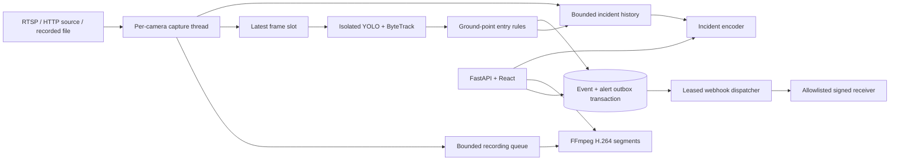

# MT Project v0.2 architecture

## Current system

Capture, inference, and recording have separate execution paths. Each camera has one capture owner, an optional inference thread, and an optional recorder thread. Capture publishes compressed JPEG packets to a latest-frame slot and a bounded recorder queue (64 entries). The latest-frame slot replaces older inference work rather than growing a backlog. The UI reports analyzed/skipped inference frames separately from written/dropped recording frames.

Packets are resized to at most 1280 pixels wide, encoded as JPEG at quality 85, then decoded for inference/recording. The resulting recording is a re-encoded visual record, not a bit-exact copy of the camera's original stream. There is no audio. H.264 output is 10 FPS with source-time resampling for files and wall-time resampling for streams. Gaps can cause duplicated frames; recording overload is visible through dropped-frame counts. Independent execution does not establish a lossless recording guarantee under arbitrary CPU, encoder, or disk pressure.

Each recording closes at the configured segment duration, EOF, stop, or stream discontinuity. Finalized MP4 files are indexed after the encoder succeeds and atomically replaces its `.part` output. Browser playback supports authenticated range requests. Existing AVI files stay available for download. Crash-left `.mp4.part` files are not automatically repaired or served.

## Camera readiness and recovery

Readiness is derived from actual source state, frame freshness, detector state, recorder state, and recording drop count. It is an operational indicator, not a camera-installation or detection-accuracy certificate. Runtime counters reset when a worker restarts; persisted health events and audit records provide history.

The FFmpeg capture backend uses five-second open/read timeouts. Streams reconnect with exponential backoff capped at 30 seconds until stopped. A failed connection creates one offline event per outage; receipt of fresh frames after an outage creates a recovered event. Initial connection failure is also recorded. Manual stop does not create an outage alarm. Files stop at EOF and can be started again explicitly.

Reconnections invalidate in-flight detections from the previous connection generation, clear incident history across the gap, finalize recording segments, and reset tracking/rule state. Camera URLs are never included in event payloads. OpenCV/FFmpeg diagnostics can contain source-related data, so runtime logs require protection.

## Incident semantics

YOLO model/tracker state is isolated per camera. A tracked object's bottom-center point entering a matching normalized polygon triggers an intrusion, including the boundary. A 15-second per-zone/per-track cooldown suppresses repeated entry alerts. Without zones, generic tracked-object events use a per-class/per-track cooldown. This does not identify a person's authorization, perform face recognition, or validate an access-control credential.

Snapshots contain the actual annotated inference frame. Events include rule identity, object box, frame dimensions, confidence threshold, source time, frame sequence, and whether the source is recorded video. A continuous recording and incident clip use captured frames without inference overlays; metadata and the snapshot explain why the event was raised.

An intrusion creates a clip in `collecting` state. A JPEG history sampled around 5 FPS supplies pre-event context; subsequent sampled frames provide the post-window. The incident encoder resamples to 10 FPS H.264 output and records the actual trigger offset. Default requested coverage is 3 seconds before and 5 after. At source start/EOF/stop/disconnection or when inference arrives too late for the retained buffer, available coverage can be shorter. Such clips are marked partial. Buffer/encoder saturation is reported as failed with snapshot evidence retained.

Incident history is bounded to 60 sampled packets per camera, at most 16 collecting incidents per camera, and 16 queued encoder jobs globally. The limits control work admission, not an absolute byte-level process-memory guarantee; JPEG size varies. Pending/encoding clip buffers are in memory. After a restart their database records become explicitly failed, because the missing frames cannot be reconstructed. Ready clips remain accessible until retention or deletion.

## Alert delivery

The event and its delivery records are persisted in the same transaction. Every delivery has an immutable ID and frozen payload. The dispatcher atomically claims due work with a 60-second lease, sends a signed HTTP request, and updates its durable result. Expired leases can be reclaimed after a crash. Delivery is at least once: receivers must deduplicate the delivery ID.

Endpoints have encrypted signing secrets, an explicit host allowlist, no URL-embedded credentials/query tokens, HTTPS for non-loopback hosts, redirects disabled, proxy environment disabled, and bounded HTTP phase timeouts. Destination hosts and DNS/network routing remain an administrator responsibility; use egress policy against unrelated management services and metadata endpoints. There is no full DNS-pinned transport implementation.

See [alert contract](ALERT_DELIVERY.md) for signatures, retry policy, pause behavior, and local failure-injection tools. The development receiver sends no email/SMS/WhatsApp; it accepts and records signed local HTTP deliveries.

## Database, roles, and retention

PostgreSQL is the deployment database; SQLite with foreign keys/WAL is used locally. Alembic revision `0002` adds evidence metadata, sample provenance, alert endpoints, and delivery records while preserving v0.1 rows. Existing events have no invented clips. Migrations run before startup and assume a single app replica. Back up the database, media, and encryption key before upgrades.

Revision `0003` adds per-attempt delivery journaling. Attempt outcomes are persisted independently of the delivery's current retry budget; expired leases preserve an unknown outcome, and manual retry retains prior history.

Workspace roles are administrator, operator, and viewer. Administrators configure sources/users/zones/receivers; operators can control cameras, capture/acknowledge incidents, inspect delivery results and retry dead deliveries; viewers can read feeds and evidence. All users belong to the same workspace. This release does not implement customer tenancy, per-camera ACLs, MFA/OIDC, or organization isolation.

Authenticated sessions use opaque hashed tokens, Argon2 password hashes, HttpOnly/SameSite cookies, revocation, same-origin write protection, and a process-local login limiter. Camera URLs and webhook secrets use Fernet encryption. The default fallback key is stored locally; production should provide and protect its own key. File protection and TLS/proxy configuration require target-environment validation.

The janitor applies configured age retention to events/media and completed/dead delivery history, then evicts oldest finalized snapshots/clips/recordings to meet the evidence quota. Quota eviction can retain event metadata without its media. Pending/sending/retry delivery records are not age-deleted, including paused backlogs; operators must manage them. Uploads, cached samples, active encoders, database size, and orphaned partial files are outside the media quota. Deploy filesystem/proxy limits and disk monitoring.

## Scaling boundary and next increments

This remains a **single-node, single-API-process system**. Threads isolate work but do not provide distributed job ownership or guaranteed process-level fault isolation. Increasing Uvicorn worker count would duplicate source owners. Multiple model instances also use additional memory. The eight-camera cap is not a validated throughput rating.

Next engineering steps are physical-device acceptance tests; sustained CPU/GPU/disk benchmarks; CI-backed PostgreSQL/container validation; process-separated media workers with durable ownership; independent stream-copy recording where supported; object-storage evidence; service metrics and recovery tooling; and customer/site isolation. Cloud and hybrid deployment additionally require authenticated edge identity, offline persistence, synchronization, and bandwidth policy. These are future work, not implemented claims.
